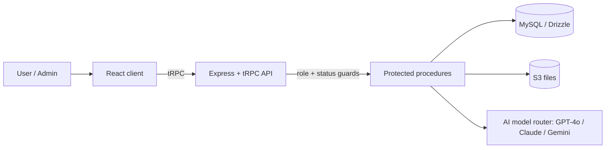

<div align="center">

# 🌌 HS Space — *One Space. Every AI.*

**A multi-model AI platform with role-based access, admin approval workflow, projects, file attachments and usage analytics.**


</div>

---

## ✨ Features

- **Multi-model AI chat** — switch between GPT-4o, Claude, Gemini and other configured models with streaming-ready orchestration
- **Persistent conversations** — create, rename, delete, organised into **project workspaces**
- **File attachments** — S3-backed uploads attached to chats
- **Approval-based onboarding** — new users land in a holding state until an admin approves them
- **Access control** — `admin` / `user` roles plus `pending`, `rejected`, `suspended` and `disabled` states enforced **on the backend**
- **Admin control center** — list users, approve / reject, change roles, toggle access
- **Usage analytics** — per-user message and token counts, model breakdown charts, platform-wide admin metrics
- **Deep-space UI** — dark-mode-first responsive dashboard with micro-interactions

## 🏗️ Architecture



**Security principle:** the backend is the source of truth for authorization — the UI only hides what the API already forbids.

## 🛠️ Tech stack

React 19 · TypeScript · Vite · Tailwind CSS · shadcn/ui · tRPC · Express · Drizzle ORM · MySQL · AWS S3 · OAuth · Vitest

## 🚀 Getting started

```bash
git clone https://github.com/hanzalasqb/hs-space.git
cd hs-space
pnpm install
# create a .env file with: database, OAuth, S3 and model provider keys
pnpm db:push
pnpm dev
```

## 🧪 Testing

Vitest covers approval gating, admin authorization, conversations and core user flows:

```bash
pnpm test
```

## 👤 Author

**Hanzala Saqib** — Full Stack AI Developer · [GitHub](https://github.com/hanzalasqb)
